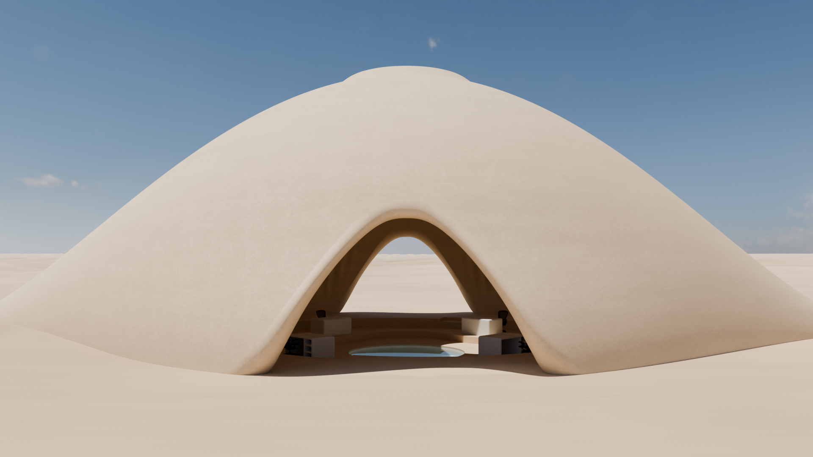
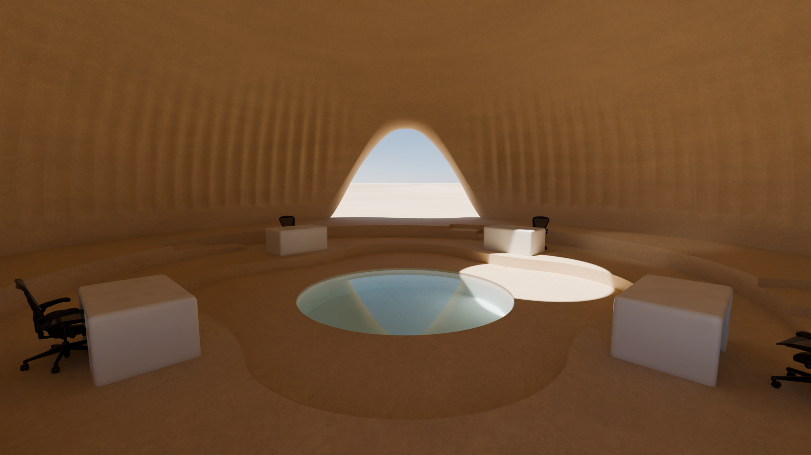
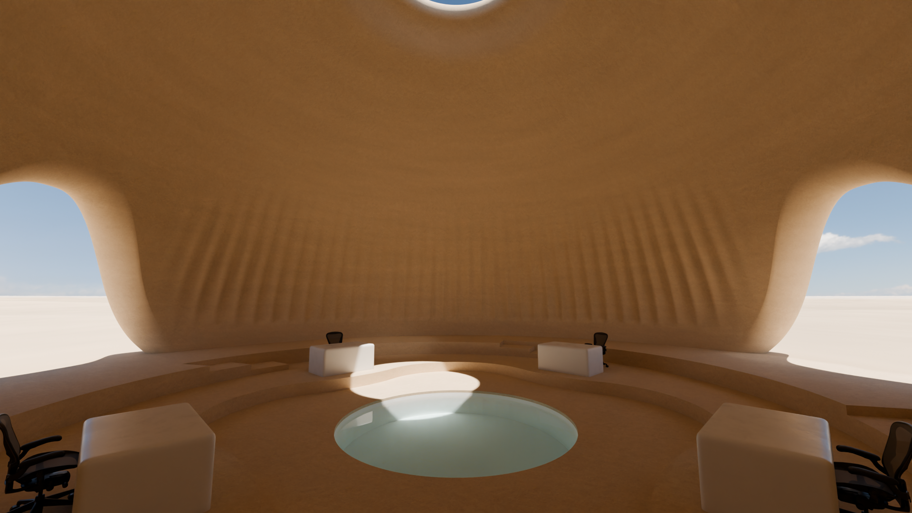
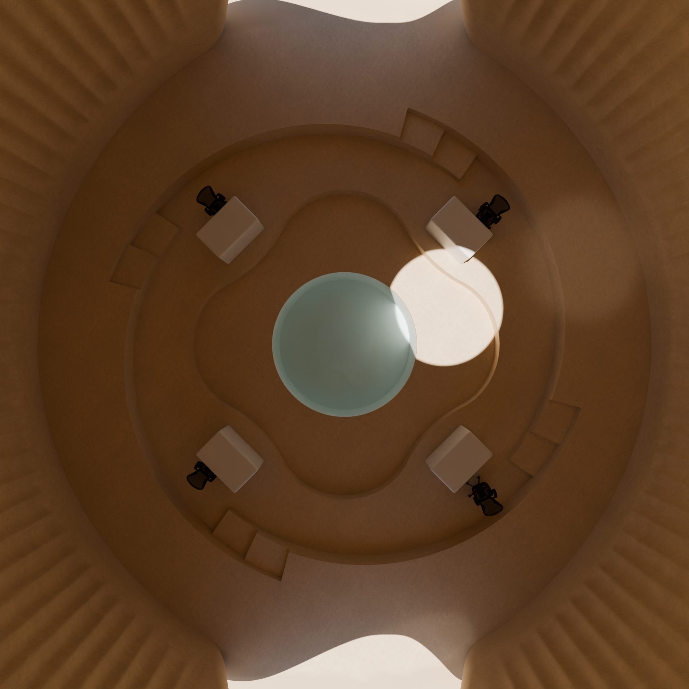
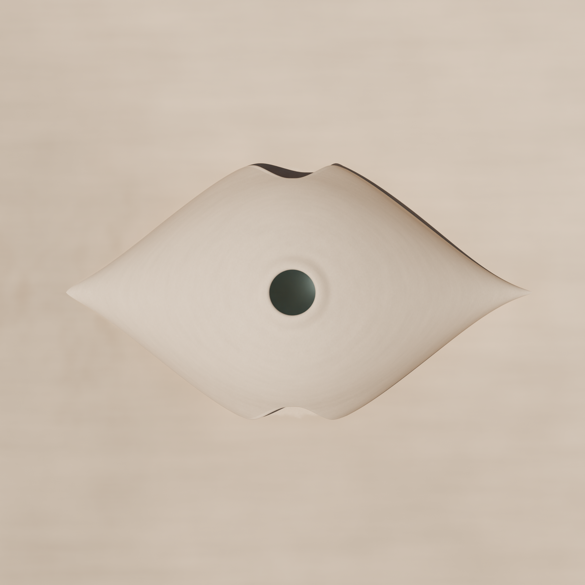

_Nestled in a boundless plain of pale sand, The Oculum rises like a giant sandstone turtle shell, sheltering a secretive order inside._

The dome is a continuous sweep of manufactured sandstone, matched to the color of the sand drifting up its walls. Large arched doorways are carved opposite each other; it's easy to imagine a turtle's head peeking out curiously.

This is where The Council of The Organum convenes. The floor descends in stepped terraces towards a sunken rounded undulating flower; at its center is a calm turquoise reflecting pool with lime wash bottom. Solid white desks sit in the flower petals, each paired with a Herman Miller Aeron chair. Their crisp geometry is a deliberate counterpoint to the hand-carved shell. The walls ripple in a wave-like relief that smooths at it climbs until it blends seamlessly with the curve of the dome.

At the top, a modest oculus opens to the clear sky, with a beam of light that slowly tracks across the floor throughout the day. Warm air rises, and pulls cooler air through the large doors, keeping the dome cool passively amidst the strong desert sun.
### From the designer:

"I knew from the start that this was an homage to the human eye. The stark interior is designed to create a sense of tranquility, and the reflecting pool represents a space where nobody can stand, but ideas can cross. Maybe it's the optic nerve, maybe it's the retina.

The desks facing each other was a challenge, so the model is parametric to allow up to 12 desks."

The project continues to evolve. The designer has plans to suspend a glass bowl on steel cables, an outside stepped terrace, a grove of palms, and a considered collection of objects for the desks.
### Gallery

